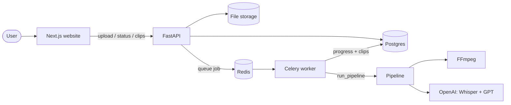
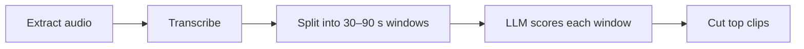

# Clip-AI

Upload a long podcast and Clip-AI finds the moments most likely to go viral, then cuts them into short clips ready to post.

## How it works



1. The user uploads a video. The API saves it and queues a job.
2. A background worker runs the pipeline:



3. The website checks progress every few seconds, then shows the clips to approve, trim, and download.

## Tech stack

| Tech | What it does here |
| --- | --- |
| **FFmpeg** | Pulls audio out of the video and cuts the final clips |
| **Whisper API** | Speech to text, with timestamps that tell us where to cut |
| **GPT + LangChain** | Scores how viral each part of the transcript could be |
| **OpenAI embeddings + pgvector** | Compares clips by meaning (planned for v2) |
| **FastAPI** | The backend API |
| **Celery + Redis** | Runs the slow pipeline in the background |
| **Postgres** | Stores videos, jobs, and clips |
| **Next.js + TypeScript + Tailwind** | The website |
| **Docker Compose** | Runs Postgres and Redis locally with one command |
| **GitHub Actions** | Runs lint and tests on every PR |

## Repo layout

| Folder | Team | |
| --- | --- | --- |
| [`pipeline/`](pipeline/) | Pipeline | Python package: video in, scored clips out |
| [`backend/`](backend/) | Backend | API, database, background worker |
| [`frontend/`](frontend/) | Frontend | Website |
| [`docs/`](docs/) | Everyone | [Architecture](docs/architecture.md) and the shared [contracts](docs/contracts/) |

Each team can work on its own. Until the other side is ready, the backend uses a **fake pipeline** (`PIPELINE_MODE=fake`) and the frontend uses a **mock API** (`NEXT_PUBLIC_API_MODE=mock`). Both return the example data in `docs/contracts/examples/`.

## Getting started

```bash
git clone https://github.com/UndergraduateArtificialIntelligenceClub/Clip-AI.git
cd Clip-AI
cp .env.example .env      # add your own API key, never commit it
```

Then follow your team's README: [pipeline](pipeline/README.md), [backend](backend/README.md), or [frontend](frontend/README.md).

## Workflow

1. Pick an issue on the Projects board and move it to **In Progress**.
2. Create a branch: `git checkout -b feature/<issue#>-short-name`
3. Open a PR into `main` with `Closes #<issue#>` in the description.
4. CI must pass and the project lead must approve before merging.

Direct pushes to `main` are blocked.
