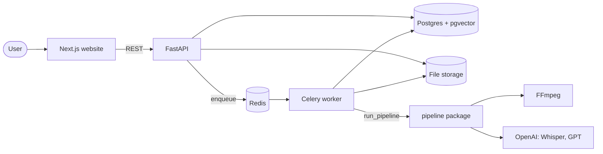

# Architecture

## Overview

1. The user uploads a video. The API saves it, creates a job, and queues it.
2. A Celery worker runs the pipeline and saves progress after each stage.
3. The website checks the job every 3 seconds, then shows the clips.

## Pipeline stages

| # | Stage | Tool | Output |
| --- | --- | --- | --- |
| 1 | Upload | Frontend + Backend | `storage/videos/{id}/source.mp4` |
| 2 | Extract audio | FFmpeg | mono 16 kHz 32 kbps MP3 |
| 3 | Transcribe | Whisper (10-minute pieces) | `Transcript` |
| 4 | Chunk | Python | `Window` list (30–90 s, new one every 15 s) |
| 5 | Score | LLM | `Candidate` list (top 5, no overlap, score ≥ 60) |
| 6 | Cut | FFmpeg | clip MP4s |
| 7 | Review | Frontend | approved clips |

## Job status

`queued → extracting_audio → transcribing → scoring → cutting → done`, or `failed` from any stage.

## Contracts

| Contract | Defined in |
| --- | --- |
| Pipeline data shapes | `pipeline/pipeline/models.py` |
| `run_pipeline()` | `pipeline/pipeline/runner.py` |
| API shapes | `backend/app/schemas.py`, `frontend/lib/types.ts` |
| Database tables | `backend/app/models.py` |
| Examples | `docs/contracts/examples/` |

See [`contracts/README.md`](contracts/README.md) for how to change them.

## API

| Endpoint | What it does |
| --- | --- |
| `POST /api/videos` | Upload (form field `file`), returns `{ video_id, job_id }` |
| `GET /api/videos` | List videos |
| `GET /api/jobs/{job_id}` | Job status and progress |
| `GET /api/videos/{video_id}/clips` | Clips, best first |
| `PATCH /api/clips/{clip_id}` | Change `status`, `start`, or `end` |
| `GET /api/clips/{clip_id}/video` | The clip's MP4 |

Errors return `{ "detail": "..." }` with a matching HTTP status. Live docs: `http://localhost:8000/docs`.
